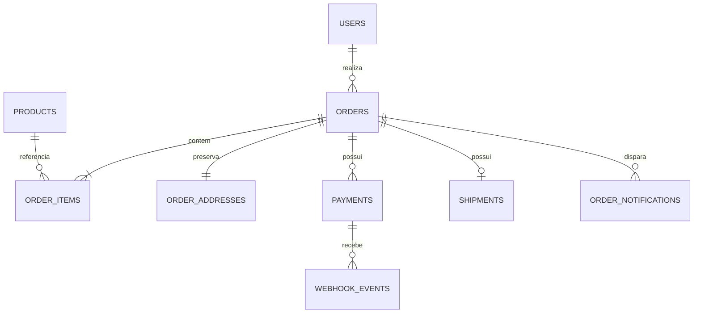

# Arquitetura — Casa das Casinhas

## Visão geral

Monólito Laravel 12 com Blade para apresentação estática, Livewire 3 para catálogo, carrinho, checkout e administração, Alpine.js para interações locais, TallStackUI 3 disponível para componentes administrativos e Eloquent/MySQL para persistência. Regras transacionais ficam em Actions; integrações HTTP ficam em Services; webhooks e notificações demoradas usam Jobs.

## DER



Produtos usam exclusão lógica para preservar o histórico. Itens guardam nome e preço como snapshot; pedidos guardam dados do cliente e endereço usados na compra. Registros financeiros têm exclusão restrita.

## Estados e regras

O pedido segue `PENDING_PAYMENT → PAID → IN_PRODUCTION → READY_TO_SHIP → SHIPPED → DELIVERED`. Cancelamento é permitido antes do envio. `OrderStatus::assertCanTransitionTo()` rejeita saltos, inclusive marcar pedido não pago como pronto.

Pagamento, envio e notificação possuem estados independentes. Totais são recalculados usando produtos ativos no banco dentro de transação. O frontend nunca define preço de produto. Webhooks Asaas são idempotentes por `(provider, external_event_id)` e só confirmam o pedido após validar cobrança e valor.

## Asaas Sandbox

Configure `ASAAS_URL`, `ASAAS_TOKEN` e `ASAAS_WEBHOOK_TOKEN`. Cadastre `POST /webhooks/asaas` no Sandbox e envie o mesmo token no header `asaas-access-token`. A cobrança usa página hospedada; retorno do navegador nunca confirma pagamento.

## Melhor Envio Sandbox

Configure `MELHOR_ENVIO_URL`, `MELHOR_ENVIO_TOKEN`, `MELHOR_ENVIO_ORIGIN_ZIP_CODE` e um `MELHOR_ENVIO_USER_AGENT` identificável. A estratégia inicial considera um volume: soma pesos por quantidade e usa as maiores dimensões. Ela não resolve encaixe ou múltiplos volumes; produtos incompatíveis devem futuramente usar um empacotador dedicado. Etiquetas só podem ser solicitadas em `READY_TO_SHIP`.

## WhatsApp Cloud API

Configure `WHATSAPP_URL`, `WHATSAPP_TOKEN`, `WHATSAPP_PHONE_NUMBER_ID`, `WHATSAPP_RECIPIENT`, `WHATSAPP_TEMPLATE`, `WHATSAPP_VERIFY_TOKEN` e `WHATSAPP_APP_SECRET`. O template em português precisa estar aprovado e possuir seis parâmetros na ordem implementada. A aceitação da API marca `SENT`; apenas webhook Meta assinado marca `DELIVERED`.

## Filas e execução

Use `QUEUE_CONNECTION=database` e mantenha o worker ativo:

```bash
php artisan queue:work --tries=3
```

Preparação local:

```bash
php artisan migrate
php artisan db:seed
php artisan storage:link
npm run build
```

## Dados de demonstração

Em ambientes que não sejam produção, `php artisan db:seed` cria ou atualiza dados idempotentes para validar o fluxo completo:

- administrador: `admin@casadascasinhas.test` / `password`;
- cliente: `cliente@casadascasinhas.test` / `password`;
- produto ativo: **Casas da Vila**, por R$ 289,90, disponível em `/produtos/casas-da-vila`.

Os acessos podem ser personalizados pelas variáveis `ADMIN_*` e `CUSTOMER_*`. O seeder é bloqueado em produção.

APIs externas devem ser testadas com `Http::fake`; não use credenciais ou operações reais nos testes.
